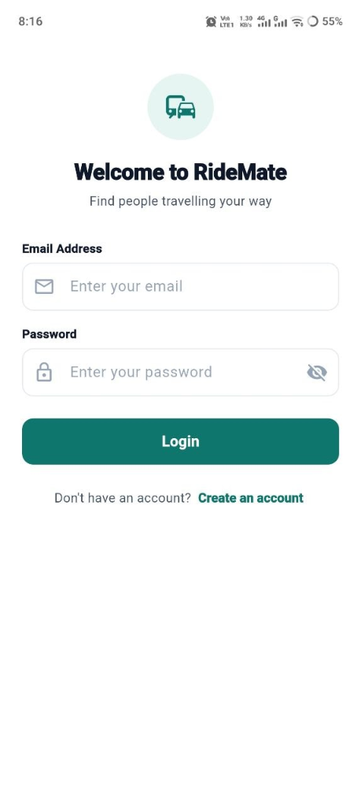
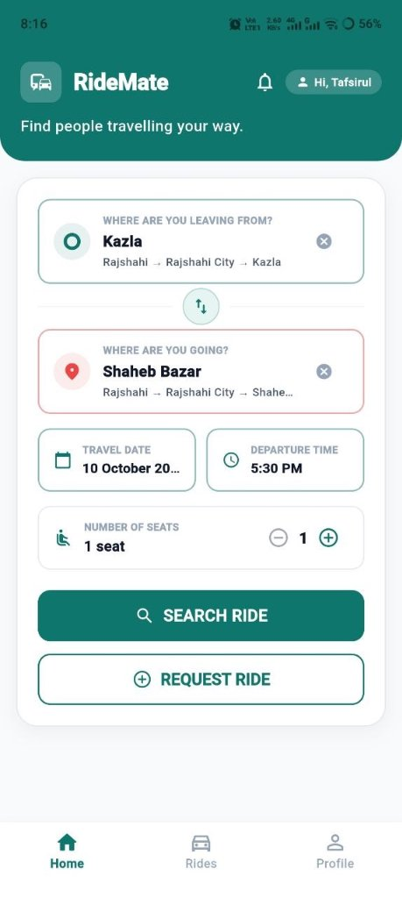
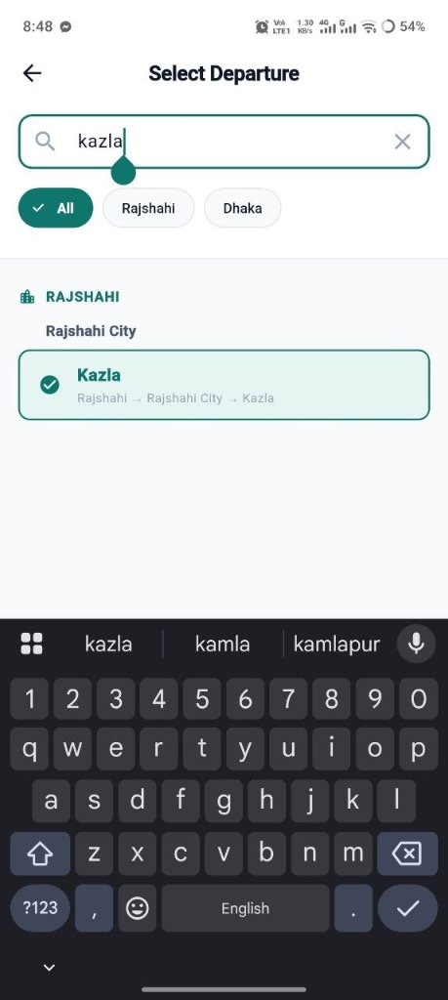
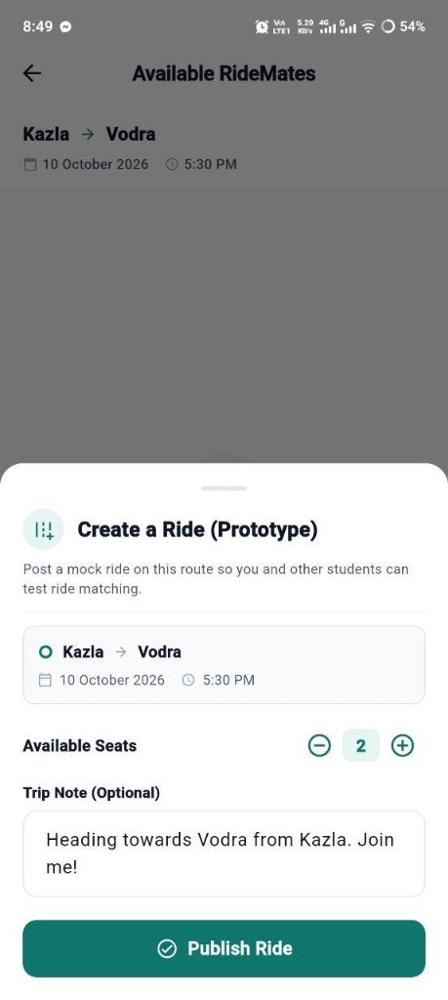
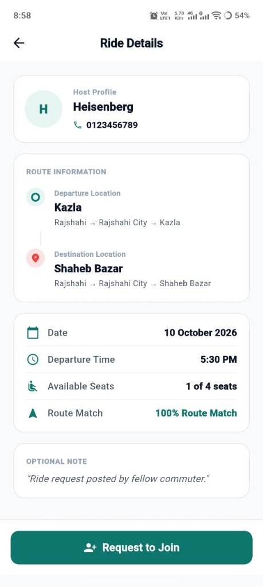
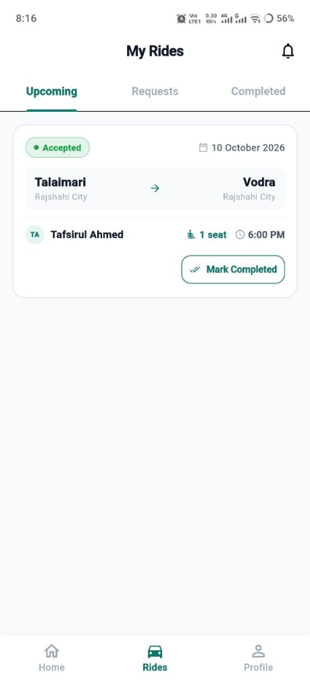
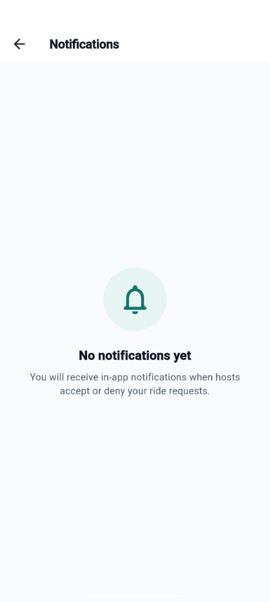
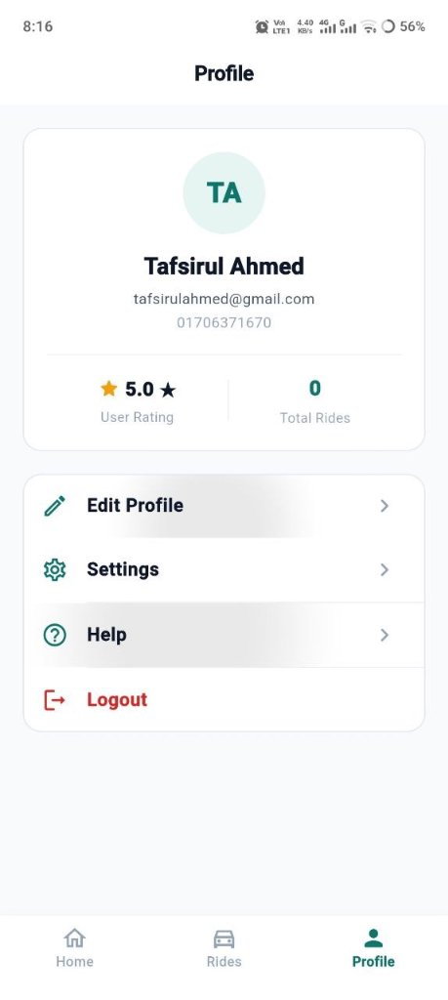

# RideMate

A station-based carpooling and ride-sharing mobile application built with Flutter and Firebase. Developed for the **CSE 2100: Software Development Project I** course at RUET.

---

## About the Project

RideMate is designed to make daily commuting simpler for university students and daily commuters. Instead of complex on-demand GPS tracking and surge pricing, RideMate uses a fixed station/route selection model (similar to train or intercity bus ticketing systems).

Users can:
- Post available seats in their vehicle along common routes (e.g., RUET, Kazla, Talaimari, Shaheb Bazar).
- Search for rides between specific stops by date and departure time.
- Send join requests and reserve seats in real time.

---

## 📱 Download

Get the latest installable Android APK directly from the [Releases](https://github.com/Rabbi-161/RideMate/releases) page.

---

## Features

- **User Accounts**: Registration and login using Firebase Authentication.
- **Station-to-Station Search**: Find rides by selecting pickup and drop-off stations along fixed corridors.
- **Offer a Ride**: Drivers can publish route details, departure time, total available seats, and vehicle info.
- **Booking & Requests**: Passengers can send ride requests; drivers can accept or decline them.
- **Seat Management**: Available seat count updates automatically when a request is accepted.
- **Request Tracking**: View current and past ride requests with status updates (Pending, Accepted, Rejected, Completed).

---

## 📸 Screenshots

| Login | Home Screen | Departure Station | Post a Ride |
| :---: | :---: | :---: | :---: |
|  |  |  |  |

| Ride Details | My Rides | Notifications | Profile |
| :---: | :---: | :---: | :---: |
|  |  |  |  |

---


## Tech Stack

- **Frontend**: Flutter (Dart)
- **Backend & Database**: Firebase (Cloud Firestore)
- **Authentication**: Firebase Auth
- **State Management**: Provider / ChangeNotifier

---

## Project Structure

```text
lib/
├── backend/
│   ├── repositories/    # Firestore queries and database operations
│   └── services/        # Auth, Ride, and Notification business logic
├── frontend/
│   ├── screens/         # UI pages (Home, Login, Search, Ride Details, Profile)
│   ├── theme/           # App colors and styling
│   └── widgets/         # Reusable UI components
├── models/              # Data models (Ride, User, Request, Location)
└── main.dart            # Entry point
```

---

## Getting Started

### Prerequisites

- [Flutter SDK](https://docs.flutter.dev/get-started/install) (version 3.x recommended)
- Android Studio or VS Code with Flutter extension
- An Android device or emulator

### Installation & Setup

1. **Clone the repository:**
   ```bash
   git clone https://github.com/Rabbi-161/RideMate.git
   cd RideMate
   ```

2. **Install dependencies:**
   ```bash
   flutter pub get
   ```

3. **Firebase Configuration:**
   - Make sure your `google-services.json` file is placed inside the `android/app/` directory.

4. **Run the app:**
   ```bash
   flutter run
   ```

---

## Authors

- **Course**: CSE 2100 - Software Development Project I  
- **Department**: Department of Computer Science & Engineering, RUET  
- **Members**:
  - Rabbi
  - Azan
